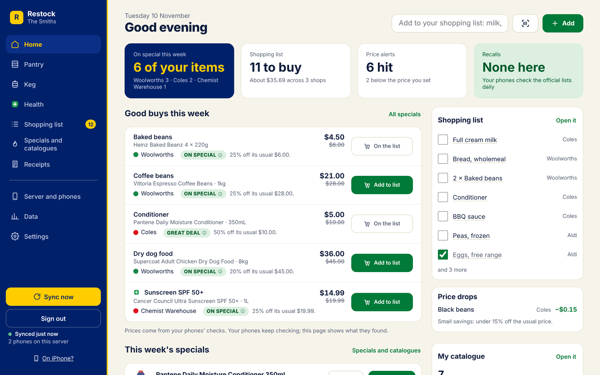
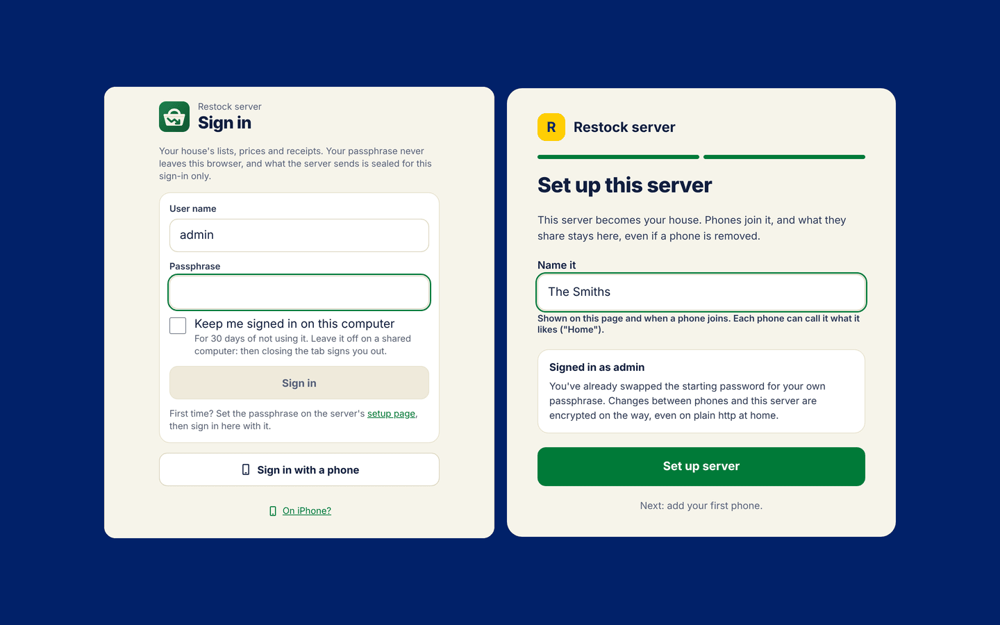
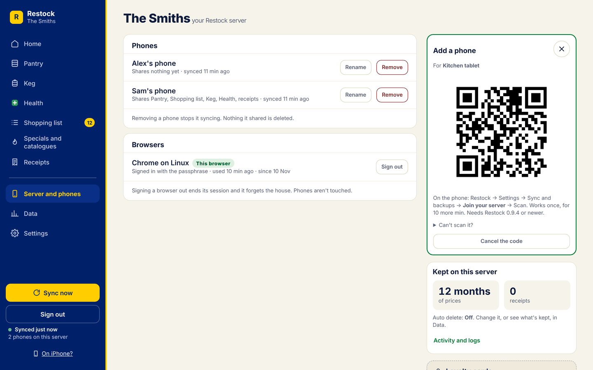
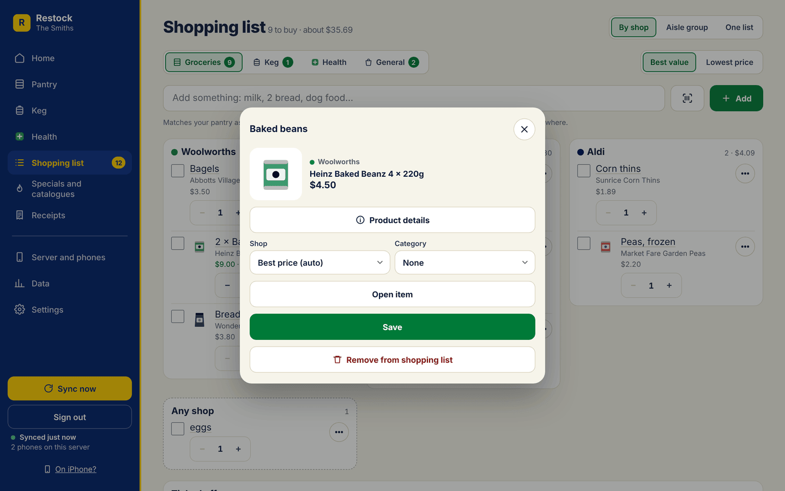
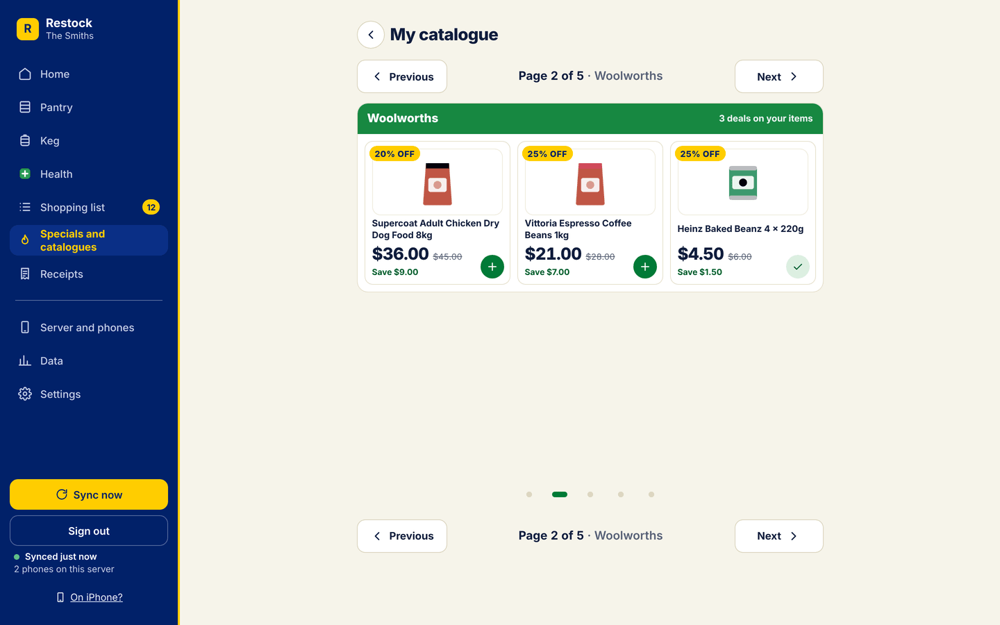
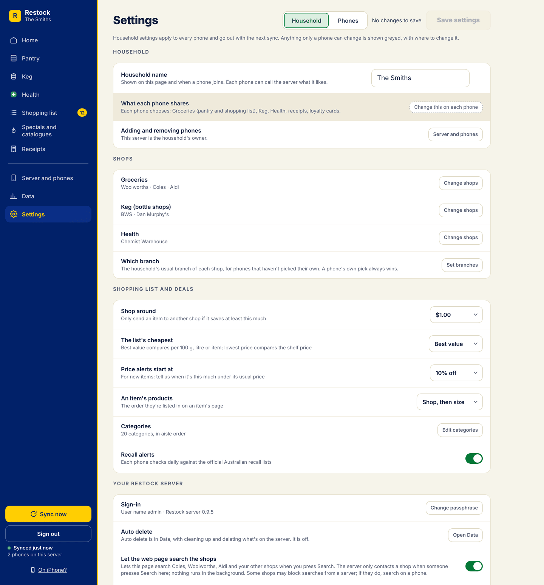
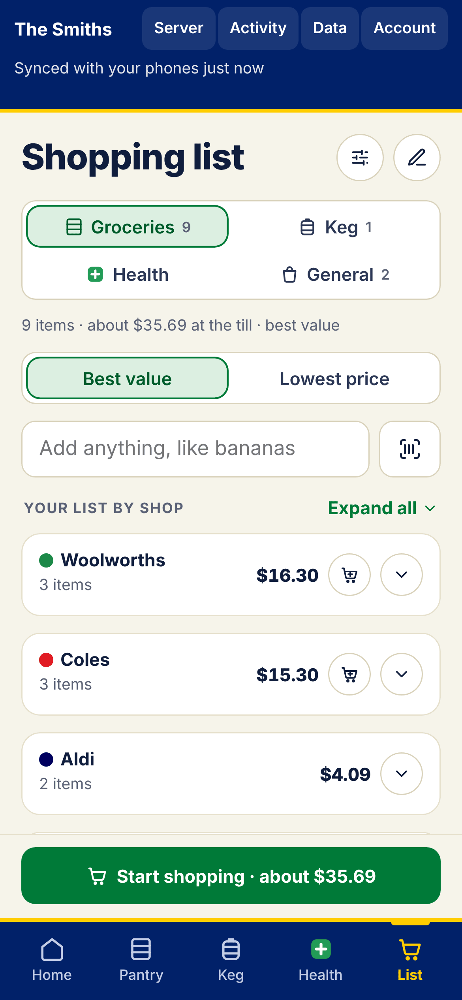
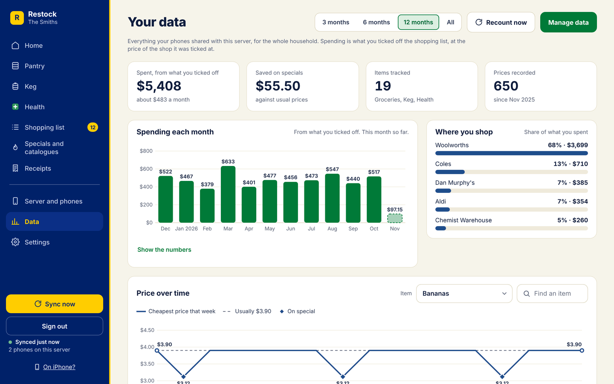
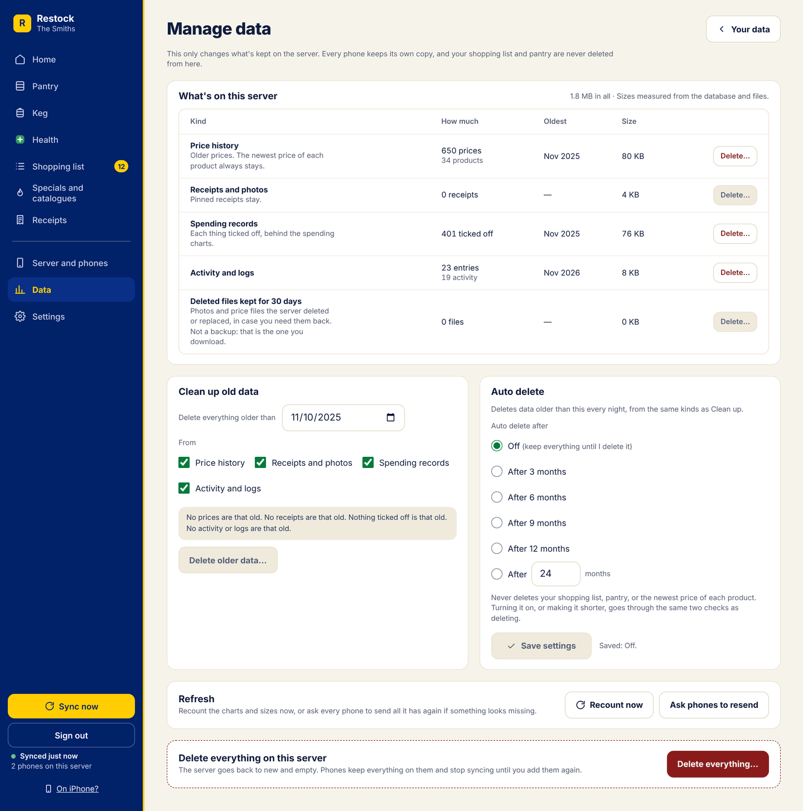

# Restock server

Your household's own server for [Restock](https://github.com/d-plenty/Restock), the local-first price tracker for Australian supermarkets, bottle shops and chemists. Run it at home on a NAS, a home server, an old laptop, a Raspberry Pi or inside Home Assistant. Your phones sync through it at home and away. It runs your shopping list with Home Assistant around the clock, shows your spending and price history in its **Data** tab, and gives you Restock in a web browser on any computer and [on iPhone](#restock-on-iphone).

**Works with Restock 0.9.4 to 0.9.11** on your phones. Use 0.9.11 on every phone to get everything in step (older phones keep syncing as before). A server that still keeps a household from Restock 0.9.2 or 0.9.3 carries on as before until you [hand it to the server](#already-using-the-server-with-restock-093).

> **Local first, always.** Every phone keeps its own full copy of what it shares. Your list, pantry and receipts work with no signal and with the server off; changes go up at the next sync. Only searching the shops needs the internet. **The server is optional:** a phone never needs it to work.

- **The server is the house.** It's a member of your household that never sleeps, and its owner. It holds the household's keys, merges what the phones share (with the same code the phones and the web app use), and hands each phone its keys when you add it.
- **Sealed on the wire.** Everything phones send or get is sealed and signed, even over plain `http://` at home. Browsers sign in without sending your passphrase or anything reusable.
- **Readable at rest, so keep it private.** To merge, keep history and run Home Assistant, the server can read what phones share with it. See [what the server can read](#what-the-server-can-read) and keep its data folder private.
- **It only contacts the shops if you let it.** With [Let the web page search the shops](#let-the-web-page-search-the-shops) turned on, and only when someone presses Search. It's off unless you turn it on.

<p align="center"></p>

## Contents

- [Which machine?](#which-machine): Home Assistant, a Raspberry Pi or mini PC, or a NAS
1. [Start it](#1-start-it) (Docker, Compose, Dockge, Portainer, TrueNAS, or [as a Home Assistant app](#as-a-home-assistant-app-no-docker-needed))
2. [Log in and set up the server](#2-log-in-and-set-up-the-server)
3. [Add your phones](#3-add-your-phones)
- [The web page](#the-web-page): Home, the Shopping list, Specials and catalogues, Undo and Save settings
- [Restock on iPhone](#restock-on-iphone)
- [Data](#data): charts, downloads, [Manage data](#manage-data) and [Auto delete](#auto-delete)
- [Let the web page search the shops](#let-the-web-page-search-the-shops)
- [What each phone shares](#what-each-phone-shares)
- [Home Assistant](#home-assistant)
- [Sign in with a phone](#sign-in-with-a-phone)
- [At home and away](#at-home-and-away)
- [Backups](#backups), [the recovery key](#the-recovery-key), [forgot your passphrase?](#forgot-your-passphrase) and [recovering deleted files](#recovering-deleted-files)
- [Updating](#updating) and [updating from 0.9.4](#updating-from-094)
- [Already using the server with Restock 0.9.3?](#already-using-the-server-with-restock-093) and [a household made on phones](#a-household-made-on-phones)
- [What the server can read](#what-the-server-can-read)
- [Settings](#settings) and [what's in the data volume](#whats-in-the-data-volume)
- [Problems?](#problems)
- [For developers](#for-developers)

## Which machine?

Anything that stays on at home works, and it needs very little: a Raspberry Pi is plenty for a household. Pick the guide for what you have, then carry on from [2. Log in and set up the server](#2-log-in-and-set-up-the-server).

| You have | Do this |
|---|---|
| Home Assistant OS (on a Pi, mini PC, NUC or a VM) | [As a Home Assistant app](#as-a-home-assistant-app-no-docker-needed). No Docker needed. |
| A Raspberry Pi 4 or 5, or a mini PC or old laptop running Linux | [Install Docker](#raspberry-pi-mini-pc-or-old-laptop), then [1. Start it](#1-start-it). |
| A NAS: TrueNAS, Synology, QNAP or Unraid | [On a NAS](#on-a-nas), using `compose.yaml`. |
| A machine that already runs Docker, Dockge or Portainer | [1. Start it](#1-start-it). |

### Raspberry Pi, mini PC or old laptop

1. **The operating system.**
   - **Raspberry Pi:** a Pi 4 or 5 with **Raspberry Pi OS (64-bit)**. Install it with [Raspberry Pi Imager](https://www.raspberrypi.com/software/). The server only comes for 64-bit (arm64), so a Pi 3 or older, or the 32-bit OS, won't run it.
   - **Mini PC or laptop:** Ubuntu Server or Debian (64-bit) is the easiest.
2. **Install Docker.** On the machine, run Docker's install script, then let your user run Docker and log out and back in:
   ```sh
   curl -fsSL https://get.docker.com | sh
   sudo usermod -aG docker $USER
   ```
   Check it worked with `docker run --rm hello-world`.
3. **Give it a fixed address,** so the phones can always find it. In your router's settings, reserve the machine's current IP address for it (often called a DHCP reservation or fixed IP). To see its current address, run `hostname -I` on it; the first number, such as `192.168.1.20`, is the one.
4. **Start the server** with the second `docker run` command in [1. Start it](#1-start-it), the one with `--restart unless-stopped`, so it starts again by itself after a power cut.
5. If the machine has a firewall turned on (Ubuntu's `ufw`, say), let the phones in: `sudo ufw allow 8787/tcp`.

### On a NAS

Use [`compose.yaml`](compose.yaml) from this repo. Change `RESTOCK_PASSWORD` in it first.

- **TrueNAS SCALE (24.10 or newer):** *Apps → Discover Apps → ⋮ → Install via YAML*, paste in `compose.yaml`, then *Save*. See [below](#with-docker-compose-dockge-portainer-or-truenas) for keeping the data on a dataset.
- **Synology (DSM 7.2 or newer, on a model with Container Manager):** install **Container Manager** from Package Center. Then *Container Manager → Project → Create*, give it a name and a folder, choose *Create docker-compose.yml*, paste in `compose.yaml`, and *Done*.
- **QNAP:** install **Container Station**. Then *Applications → Create*, name it `restock-server`, paste in `compose.yaml`, and *Create*.
- **Unraid:** install the **Docker Compose Manager** plugin from the Apps tab. Then *Docker → Add New Stack*, name it `restock-server`, *Edit Stack → Compose File*, paste in `compose.yaml`, *Save Changes*, then *Compose Up*.

The NAS's own address (the one you open its settings with) is the server's address, on port 8787: for example `http://192.168.1.10:8787`.

## 1. Start it

You need [Docker](https://docs.docker.com/get-docker/) (see [Which machine?](#which-machine) if you don't have it yet). Run this on the machine that'll be the server:

```sh
docker run -d --name restock-server -p 8787:8787 -v restock-data:/data -e RESTOCK_PASSWORD=admin ghcr.io/d-plenty/restock-server:latest
```

That's it. It keeps everything in a Docker volume called `restock-data`. `RESTOCK_PASSWORD` is only for the first login; it stops working once you've set a passphrase. If other people use your network, change `admin` to a password of your own before you run it.

While the password is still `admin` (or another one anyone could guess, like the `change-me-now` in `compose.yaml`), the first login only works from your home network or Tailscale, not through Cloudflare Tunnel or anything else from the internet, and only with an address a home network has (an IP address, `localhost`, a `.local`, `.lan`, `.home.arpa` or `.ts.net` name, a one-word name, or your `RESTOCK_HOME_URL` or `RESTOCK_AWAY_URL`), so a web page elsewhere can't use your browser to do it. To set it up from somewhere else, start the server with your own `RESTOCK_PASSWORD`.

To have it start again after a restart, and locked down a bit more, use this instead:

```sh
docker run -d --name restock-server --restart unless-stopped --read-only --cap-drop ALL --security-opt no-new-privileges -p 8787:8787 -v restock-data:/data -e RESTOCK_PASSWORD=admin ghcr.io/d-plenty/restock-server:latest
```

Check it's running with `docker logs restock-server`. You should see the address to open.

### With Docker Compose, Dockge, Portainer or TrueNAS

Use [`compose.yaml`](compose.yaml) from this repo. Change `RESTOCK_PASSWORD` in it first.

- **Docker Compose:** put `compose.yaml` in a folder and run `docker compose up -d` there.
- **Dockge:** *+ Compose*, name it `restock-server`, paste in `compose.yaml`, then *Deploy*.
- **Portainer:** *Stacks → Add stack*, paste in `compose.yaml`, then *Deploy the stack*.
- **TrueNAS SCALE (24.10 or newer):** *Apps → Discover Apps → ⋮ → Install via YAML*, paste in `compose.yaml`, then *Save*. To keep the data on a dataset instead of a Docker volume, change `restock-data:/data` to your dataset's path, for example `/mnt/tank/apps/restock:/data`, and let the server (user 1000) write to it: `sudo chown -R 1000:1000 /mnt/tank/apps/restock`.

### As a Home Assistant app (no Docker needed)

If you run Home Assistant OS (or a Supervised install), the server can run inside Home Assistant as an app (apps were called add-ons before Home Assistant 2026.2). Your Home Assistant backups then include it.

1. In Home Assistant, go to **Settings → Apps → App store**, open the **⋮** menu, choose **Repositories**, and add `https://github.com/d-plenty/restock-server`.
2. Find **Restock server** in the App store and **Install** it.
3. In its **Configuration** tab, set **password** to your own, then **Save** and **Start**.
4. **Open web UI**, or go to `http://<your Home Assistant's address>:8787`, and carry on from [step 2](#2-log-in-and-set-up-the-server).

Away from home, give phones an address that reaches port 8787 on Home Assistant: Tailscale, or a Cloudflare Tunnel hostname pointing at `http://<Home Assistant's address>:8787` (then set **trust_proxy** to `cloudflare`). Home Assistant Container and Core installs don't have apps: use Docker as above.

## 2. Log in and set up the server

1. On a computer on the same network, open `http://<the server's address>:8787`, for example `http://192.168.1.10:8787`. (On the server itself, `http://localhost:8787` works too.)
2. Log in with **admin** and your `RESTOCK_PASSWORD`. If it says *"Finish setting up Restock server from your home network first"*, you're coming in from outside your home network with the default `admin` password (or `change-me-now`): do this step at home (or over Tailscale), or restart the server with your own `RESTOCK_PASSWORD`.
3. Choose a **passphrase**. Four or more random words works well, like *kettle orbit lemon fence*, or anything with at least 20 characters. The page won't take common passwords, the user name or "admin". From now on that's how you sign in, and the first-login password no longer works.
4. **Set up this server:** give your house a name, like *The Smiths*. Everyone you add sees it. The server makes the household: its keys, its owner key and a [recovery key](#the-recovery-key).
5. Sign in with your passphrase.

Your passphrase never leaves the browser. The browser turns it into a key; the server keeps a hash of it and a key that proves you know it, and each sign-in proves that with a fresh challenge, so watching a sign-in gives nothing to replay. Keep the passphrase somewhere safe, like a password manager.

<p align="center"></p>

## 3. Add your phones

1. On the web page, open **Server and phones** and choose **Add a phone**. Type who it's for, like *Sam's phone*. A QR code appears. It works once, for 10 minutes.
2. On the phone, open Restock and go to **Settings → Sync and backups → Join your server**, and scan the code. The phone says *"This phone was added as Sam's phone on The Smiths"*.
3. Choose [what this phone shares](#what-each-phone-shares), then do the same for each phone, with a new code each time.

The code has the server's own key in it, so the phone knows it's talking to your server and nobody else can answer in its place. Each phone gets its own key for the server (the server keeps only its public half) and gets the household's keys sealed to it.

**Server and phones** shows each phone, what it shares, its Restock version and when it was last seen. **Remove** takes a phone off straight away and gives the household a new key, so a lost or stolen phone can't read anything changed after that. Nothing it shared is deleted. A phone can also **Leave** by itself.

<p align="center"></p>

## The web page

Sign in on any computer and you have Restock laid out for a big screen, from what your phones share:

- **Home:** a greeting and the date, your Shopping list, and this week's specials on the things you buy.
- **Shopping list:** Groceries, Keg, Health and **General**, with the views **By shop · Aisle group · One list**. Click a line to open the item, with a big photo at the top; only the tick box ticks it off. Type in the add box to add from your pantry, or the words as they are.
- **Pantry, Keg and Health:** your items, their prices at each shop, and the history the server keeps.
- **Specials and catalogues:** every shop you follow, with its website, specials and catalogue links, plus This week's specials and My catalogue from what your phones found. **Previous** and **Next** sit above and below a catalogue's pages (the arrow keys work too), and clicking a product opens it.
- **Pick my milk:** a line added as words (by Home Assistant, say) has a Pick button. If nothing in your pantry matches, it can [search the shops](#let-the-web-page-search-the-shops) for it, when that's turned on.
- **Undo:** after a change, a big white **Undo** shows at the bottom of the sidebar (with Sync now and Sign out) for a few seconds. One click (or Ctrl+Z, Cmd+Z on a Mac) puts it all back, even after "Add all to my list".
- **Save settings:** settings wait for the green **Save settings** button, at the top right of the page and at the bottom. Leaving with changes not saved asks first.
- **Data:** see [Data](#data).

<p align="center"></p>

<p align="center"></p>

<p align="center"></p>

## Restock on iPhone

There's no iPhone app, but your server's web page goes on an iPhone's home screen. It opens like an app, and your Shopping list works with no signal.

**It needs the server's https address.** iPhones only keep a web app for offline use, and only let it use the camera, on https. Set up one of these first (see [at home and away](#at-home-and-away)):

- **Cloudflare Tunnel**, with `RESTOCK_AWAY_URL=https://restock.example.com`.
- **Tailscale's https:** `tailscale serve` gives the server an `https://<name>.<tailnet>.ts.net` address.

Then, on the iPhone:

1. Open the server's https address in Safari.
2. Tap Share, then **Add to Home Screen**.
3. Tap **Add**. Open Restock from your home screen and sign in.
4. Tick **Keep me signed in**, so it still opens when you're offline.

The steps are also on the sign-in page and in the sidebar, under **On iPhone?**. On Android, open the https address in Chrome, then tap the menu and **Add to Home screen** (or **Install app**).

**With no signal:**

- Your Shopping list opens, and you can tick things off, add and remove them.
- Scanning a barcode adds things you already have in your pantry.
- Your changes go to the server when you're back online. The list shows when it was last updated.
- Prices, specials and settings need the server.

**Good to know:**

- **Open it once with a connection** after you sign in, so it can keep a copy for offline.
- **Sign out** takes the list off that iPhone. A sign-in made by scanning with a phone isn't kept for offline: sign in with your passphrase.
- **No background price checks, alerts, widgets or Wi-Fi sync** on iPhone. Those need the Android app.

<p align="center"></p>

## Data

The **Data** tab (between Server and phones and Settings) shows what's on the server, and what it means.

- **Spending each month,** **where you shop** and **saved on specials.** Spending is what you tick off your shopping list: the price at the shop you ticked it at, times how many, on the day. It isn't from receipts, and it isn't a budget.
- **Price over time** for any item, at each of your shops, with what you paid.
- **What you buy most,** with the usual price, what you last paid and where it's cheapest now. **Download as a spreadsheet** saves that table.
- Ranges: **1 month · 2 months · 3 months · 6 months · 1 year**.
- **What's on this server, by kind:** prices, receipts, statistics, logs and deleted files kept for 30 days, with how much room each takes and the disk space left.
- **Download your data:** a **spreadsheet (.xlsx)**, **CSV files (.zip)**, or a **full export file (.json)** to move your data to another machine. The full export file is an open, documented format (`restock-export`, see [For developers](#for-developers)). None of them has loyalty or gift card numbers or PINs, receipt text or photos, keys, passwords or the Home Assistant token. They do have your list, pantry, prices and spending, so keep them private.
- **Import data:** add products and prices from a file (the full export file, or the CSV files from the zip) on top of what's here. It never replaces or deletes anything and never touches your list or pantry. A preview shows what it will add and skip, then you confirm with your passphrase. Imported prices are marked **imported**. Up to 100 MB, 25,000 products and 500,000 prices a file. Files with card numbers, PINs, passwords, keys or receipts are refused. Only import prices you're allowed to use: shops' websites have terms of use. The format is in [docs/restock-import.md](docs/restock-import.md).
- **Refresh:** **Recount now** works out the spending again from what the server knows. **Ask phones to resend** asks each Restock 0.9.5 phone to send everything it has again at its next sync (once a day at most). Nothing doubles.

<p align="center"></p>

### Manage data

**Data → Manage data** deletes from the server. Every delete has **two checks**:

1. The first says what will go and what stays, and suggests downloading a backup first.
2. The second asks you to type **DELETE** (or **DELETE EVERYTHING**) and your passphrase.

- **Delete a kind:** older prices, receipts and their photos, what you ticked off (the statistics), activity and logs, or the deleted files kept for 30 days.
- **Clean up old data:** delete everything older than a date, from the kinds you tick.
- **Delete everything on this server:** the server goes back to new and empty, for everyone. Every phone is unlinked and keeps all its own things; you can add them again. Your sign-in and the server's own settings stay.

Nothing here deletes your shopping list, your pantry, the newest price of each product, pinned receipts, or anything on the phones. Phones aren't told to delete anything.

### Auto delete

**Auto delete** (in Manage data) deletes data older than you choose, every night at about 3 am (in the server's time zone, `TZ`): **Off**, **after 3, 6, 9 or 12 months**, or any number of months from 1 to 120. It covers prices, receipts and their photos, the phones' moved-off history (`archive/`), statistics and logs, with the same things kept as above.

- **Off is the start** on a new server: nothing is deleted until you delete it.
- **A server updated from 0.9.4 keeps its setting** (12 months unless you changed it).
- **Phones on 0.9.4 only understand 3, 6, 9 or 12 months.** Choose another number and those phones show Auto delete as off, but the server still deletes older data every night.
- **Turning it on, or making it shorter,** deletes straight away, so it goes through the same two checks. The first says what will go and when ("data older than 9 months is deleted every night").
- **Each phone keeps its own price history,** as long as its own setting says.

<p align="center"></p>

## Let the web page search the shops

**Off unless you turn it on.** Phones search the shops themselves. A web browser can't (the shops' sites don't let other sites read them), so to add things from the web page that aren't in your pantry yet, the server has to ask the shops for you.

Turn it on in **Settings → Let the web page search the shops** (signed in with your passphrase), then **Save settings**. Then:

- **Search** in the web's add box, or in the Pick sheet for a line that matches nothing ("chopsticks"), searches your shops on that tab, the same way a phone does. **Track** or **Add to list** saves a product with the price the shop gave the server.
- **The server only contacts a shop when someone presses Search.** Nothing runs in the background, nothing is fetched on a timer, and no shop sign-ins are kept.
- **Only the built-in shops** are asked, at their own addresses. Shops people added by hand are never searched from the server.
- **The shops see your server's internet address** instead of a phone's. The server's log says that a search happened, on which tab and how each shop answered, but never what was searched for.
- **Limits:** 10 searches a minute for each browser, 60 an hour for the server.

**Some shops may block a server.** On a phone, Restock can fall back to a hidden browser when a shop's bot check says no; the server can't. Then the page says *"Coles blocked the search from your server. Search it on a phone instead."* Coles is the most likely to block it. Woolworths, Aldi, Dan Murphy's and BWS are the most likely to answer. Bottle shops and chemists answer only when their search page carries its products as data.

**See which shops answer your server** before you rely on it. It asks each shop once, prints what came back and saves nothing:

```sh
docker compose exec restock-server node scripts/try-search.mjs
```

With `docker run`, use `docker exec restock-server node scripts/try-search.mjs`. To try one word at some shops: `docker compose exec restock-server node scripts/try-search.mjs "weet-bix" coles aldi`. With the Home Assistant app, run it from any computer at home that has Docker: `docker run --rm ghcr.io/d-plenty/restock-server:latest node scripts/try-search.mjs`.

## What each phone shares

Each phone chooses, in **Your server → What this phone shares**: **Groceries** (pantry, Shopping list and General list, on by default), **Keg** and **Health** (off: everyone on the server would see what you buy there), **Receipts** (off) and **Loyalty cards** (off; best kept on your phone). What a phone doesn't share never leaves it. The server also checks: it takes from each phone only what that phone says it shares.

Turning something off stops sending it; what it already shared stays on the server, unless you tick **Also take what this phone shared off the server**, which deletes that phone's own shared things for that tab (other people's stay). Prices and product details found at the shops stay for the household: they're about the shops, not about you.

## Home Assistant

In a household on the server, the shopping list syncs with Home Assistant **from the server**, all the time, for every phone and browser: one list, one token. On the web page, open **Home Assistant**, enter the address you open Home Assistant with (for example `http://homeassistant.local:8123`, or `http://homeassistant:8123` for the Home Assistant app), paste a **long-lived access token** (your Home Assistant profile → Security), **Test connection**, pick the to-do list and turn it on. It syncs every minute and a few seconds after a phone changes the list.

A voice add that matches one of your items goes on that item's list (Pantry first, then Keg, then Health). One that matches nothing goes on the **General** list.

The token is kept on the server only (in `keys.json`); it's never shown again, never sent to phones or browsers, and never written in the logs. Plain `http://` only goes to an address at home or on Tailscale; anything else needs `https://`. If a phone ran Home Assistant before (Restock 0.9.3), it moves here when you hand the household over or when that phone updates; until then the server won't run it twice, and the page says where it's still running.

## Sign in with a phone

On a computer you don't use often, you can skip the passphrase: on the sign-in page choose **Sign in with a phone** and scan the code with a phone on this server. The code lasts 2 minutes and works once. Such a sign-in ends after 12 hours unused, or straight away if you remove the phone that let it in. It can't change the server's settings or the passphrase, see the recovery key, download a backup, remove phones or delete data. Removing a phone, the recovery key, backups and every delete ask for your passphrase again, even when you're signed in with it.

Signed in somewhere you shouldn't be? **Browsers** lists every signed-in browser and can end one, and **Sign out everywhere** ends them all.

## At home and away

Phones try the **home** address first, then the **away** address. Away from home the address has to be **https://**, unless it's a Tailscale address (Tailscale already encrypts the connection). Plain `http://` only works on your home network. [Restock on iPhone](#restock-on-iphone) needs https everywhere, even at home.

The addresses go into the phones' QR code and into the household's signed record, so set them **before** you add phones. Phones already on the server pick up a change from the server's own file at their next sync (while they can still reach it at the old address):

- `RESTOCK_HOME_URL`, for example `http://192.168.1.10:8787`. If you leave it out, it's the address you opened the web page with.
- `RESTOCK_AWAY_URL`, for example `https://restock.example.com`.

Add them with `-e` in the `docker run` command (for example `-e RESTOCK_HOME_URL=http://192.168.1.10:8787`), or in `compose.yaml`.

**Tailscale** (the simplest): install [Tailscale](https://tailscale.com) on the server machine and on the phones, then set `RESTOCK_AWAY_URL` to `http://<the server's Tailscale address>:8787`, for example `http://100.101.5.7:8787`. For an https address (needed on iPhone), run `tailscale serve` for an `https://<name>.<tailnet>.ts.net` address and use that.

**Cloudflare Tunnel:** point a tunnel's public hostname at the server (`http://restock-server:8787` if `cloudflared` runs in the same Docker network, otherwise `http://localhost:8787`). Then set:

```
RESTOCK_AWAY_URL=https://restock.example.com
RESTOCK_TRUST_PROXY=cloudflare
```

`RESTOCK_TRUST_PROXY` tells the server to read the visitor's real address from Cloudflare, so the lock-out after wrong passphrases hits the person guessing, not everyone. It only believes those headers on connections from your home network or Docker (where the tunnel runs), so someone reaching the port from the internet can't make up an address (but someone on your home network can: with it set, remove the `ports:` lines so only the tunnel reaches the server). Don't put Cloudflare Access (a login page) in front of it: phones can't get past it.

**Your own reverse proxy** (Caddy, Traefik, Nginx Proxy Manager): the same, with `RESTOCK_TRUST_PROXY=true`. The proxy must set `X-Forwarded-For` and `X-Forwarded-Proto`. Serve it at the root of its own hostname (like `restock.example.com`, not `example.com/restock`).

Whatever you use, **don't forward port 8787 on your router**. Away access should go through Tailscale or https.

Over plain `http://` the server also serves the web page's own code, so someone who can change traffic on your network could change the page. Phones are fine over plain http at home (everything they send is sealed and signed, and they know the server's key), but for the web page, use https or Tailscale if you don't trust your network.

## Backups

**Settings → Download a backup** on the web page makes one encrypted file of everything the server keeps (the household, its keys, every phone's files and photos, the history and the logs). You type a backup passphrase for it when you download; the file is useless without it, so keep the two apart. To restore, into a new, empty data folder:

```sh
node scripts/restore.mjs restock-server-2026-11-10.rsb ./restored-data
```

(In Docker: `docker run --rm -it -v "$PWD":/backup -v restock-data:/data ghcr.io/d-plenty/restock-server:latest node scripts/restore.mjs /backup/restock-server-2026-11-10.rsb /data` into an empty volume.) Then start the server with that folder. Phones carry on as before.

You can also copy the whole `restock-data` volume (stop the server first so the database is consistent):

```sh
docker stop restock-server
docker run --rm -v restock-data:/data:ro -v "$PWD":/backup alpine tar czf /backup/restock-data.tgz -C /data .
docker start restock-server
```

A copy like that is **not encrypted**: it can be read like the server itself. Keep it as private as the server's data folder. Your phones have their own copy of what they share anyway.

The Data tab's downloads (.xlsx, CSV, the full export file) are for reading your data and moving it, not for restoring a server. Use the encrypted backup for that.

### The recovery key

**Settings → Recovery key** shows the household's recovery key. Save it somewhere safe. If the server is ever lost, a phone can take the household back with it (Restock's **Take over**), and the household carries on without a server. A server that sees the household was taken back stops acting as its owner and its web page offers to start afresh.

## Forgot your passphrase?

Reset it:

```sh
docker exec restock-server touch /data/reset-passphrase
docker restart restock-server
```

Then open the web page, log in with **admin** and your `RESTOCK_PASSWORD` again, and choose a new passphrase. Every browser is signed out; your household, phones and files are kept.

## Recovering deleted files

Phones move older prices and receipt photos to the server and then delete their own copy, so the server's `archive/` and `photos/` files may be the only ones. They're never simply deleted: when a phone deletes one (or another phone replaces it with something different), or Auto delete or Manage data removes one, the old copy goes to `trash/<when>/` in the data volume, with the same name it had under `files/`, for 30 days. The trash is emptied of anything older once a day and when the server starts (or straight away if you delete the deleted files kept for 30 days in Manage data). It counts towards `RESTOCK_MAX_TOTAL_MB`, and phones never see it. The **Activity** page lists each `trashed` file and where it went.

To put one back, stop the server, move it back under `files/`, and start it again:

```sh
docker stop restock-server
docker run --rm -v restock-data:/data alpine sh -c "ls -R /data/trash"
docker run --rm -v restock-data:/data alpine sh -c "mkdir -p /data/files/photos && mv /data/trash/2026-11-09T22-56-00.123Z/photos/<sha256>.bin /data/files/photos/ && chown -R 1000:1000 /data/files"
docker start restock-server
```

(Use the folder and name `ls` showed; an archive goes back to `/data/files/archive/<phone>/`.) The phones see it again at their next sync.

Who can delete what: a phone only its own `archive/<phone>/` files, and a photo only if it's the phone that put it on the server (another phone may use the same photo: when it asks, the photo stays). The web page only through Manage data and Auto delete, with their two checks.

## Updating

```sh
docker pull ghcr.io/d-plenty/restock-server:latest
docker rm -f restock-server
```

Then run the same `docker run` command as before. Your data stays in the volume.

- **Docker Compose:** `docker compose pull && docker compose up -d`.
- **Dockge:** open the stack, then *Update*.
- **Portainer:** open the stack, then *Pull and redeploy*.
- **TrueNAS:** *Apps*, select it, then *Update* (or *Edit → Save* to pull again).
- **Home Assistant app:** *Settings → Apps*, open **Restock server**, then *Update*.

Each version is also tagged by number (for example `ghcr.io/d-plenty/restock-server:0.9.11`) if you'd rather choose when to update. It needs Node 22.13 or newer if you run it without Docker (it says so and stops otherwise).

### Updating from 0.9.4

1. **Update the server** as above. Your household, phones, history and settings stay. There's nothing to scan or hand over.
2. **Update your phones to Restock 0.9.11.** Phones still on 0.9.10, 0.9.9, 0.9.8, 0.9.7, 0.9.6, 0.9.5 or 0.9.4 keep syncing as before.
3. **Check Auto delete** in **Data → Manage data**. Your 0.9.4 **Keep data for** setting carries on as Auto delete (12 months unless you changed it).
4. **Want to search the shops from the web page?** Run the [try-search script](#let-the-web-page-search-the-shops) to see which shops answer, then turn it on in Settings.

Good to know:

- **Phones still on 0.9.4 don't show the General list.** Its lines stay on the server and the 0.9.5 phones, and reach that phone when it updates.
- **Ask phones to resend** only works with Restock 0.9.5 phones.
- **Auto delete can now be any number of months from 1 to 120.** Phones still on 0.9.4 only understand 3, 6, 9 or 12: for any other number they show it as off, but the server still deletes older data every night.
- **Pharmacy is now called Health**, on the web page and the phones. Nothing else about it changed.
- **Spending in the Data tab** starts from what's ticked off on your list now and from here on. What was ticked off and cleared before the update isn't counted.

## Already using the server with Restock 0.9.3?

Updating the server changes nothing on its own: it keeps your 0.9.3 household as it was, end-to-end encrypted, and phones and browsers carry on. When your phones have Restock 0.9.4 or newer:

1. On the web page, sign in, open **Server and phones → Take this household**. A QR code appears (10 minutes, once).
2. On the household's **owner phone**, open **Your server → Hand this household to the server** and scan it.

The owner phone seals the household's keys, its owner key and (if it runs it) Home Assistant to the server's key. The server checks them against the household before changing anything, then reads every phone's file into its own copy and becomes the owner. The other phones carry on without scanning anything: they update themselves to the server at their next sync. A phone still on 0.9.3 says *"Update Restock to keep syncing with your server"*, keeps everything it has and works on its own until you update it. What the household shares (its tabs and receipts) stays as it was until every phone in it is on 0.9.4 or newer, so a phone still on 0.9.3 never starts sharing more because of the move; after that each phone decides for itself ([what each phone shares](#what-each-phone-shares)).

If the server stops part-way (a power cut, say), it either finishes or puts everything back as it was when it starts again; the owner phone stays the owner until it sees the change, so you can just try again.

### A household made on phones

If your phones already share a household over Wi-Fi or a cloud drive folder: on a new server, scan the first **Add a phone** code with the household's owner phone, and choose **Bring <household> onto <server>**. The other phones see the change and offer to connect themselves. A phone that isn't in a household, or is in another one, joins and its things on the tabs it shares go up.

## What the server can read

**In a household on the server (0.9.4 and newer),** the server can read what phones share with it: the shopping lists and pantry, Keg and Health if shared, receipts and their photos if shared, prices including years of history, what's been ticked off (for spending), the household record, each phone's settings summary, the Home Assistant token, and the activity log and logs. It needs to, to merge, keep history and statistics, run Home Assistant and show the web app. Loyalty card numbers are blanked before they reach its database (a phone that shares cards still puts them in its sealed file, which the server can open).

**It never has:** anything a phone doesn't share, your passphrase, or the phones' private keys.

**It only talks to the shops** if you turn on [Let the web page search the shops](#let-the-web-page-search-the-shops), and then only when someone presses Search. The shops then see your server's internet address.

**Anyone with a copy of the data folder can read all of the above.** So:

- keep the data folder private (don't share the volume or dataset, and keep its backups as private as the server);
- put it on an encrypted disk if you can (an encrypted TrueNAS dataset, LUKS, FileVault, BitLocker);
- use the [encrypted backup](#backups) for copies that leave the machine, and keep the Data tab's downloads private too;
- run the server yourself, from this image, on a machine you trust: it also serves the web app to your browser.

On the network everything stays sealed: phone traffic always, browser traffic too (with the plain-http caveat above). The makers of Restock never see any of it.

**A 0.9.3 household (before the handover)** is still end-to-end encrypted: the server stores sealed files it can't open and sees only file names, sizes, times, the phones' names and the activity log.

## Settings

| Variable | Default | What it does |
| --- | --- | --- |
| `RESTOCK_PASSWORD` | `admin` | The first-login password. Only works until a passphrase is set. While it's `admin`, `change-me-now` or a few others anyone would try, only from your home network or Tailscale |
| `RESTOCK_USER` | `admin` | The user name. It's fixed when you set the passphrase |
| `RESTOCK_HOME_URL` | the address you open the web page with | The address phones use at home (goes in the phones' QR code and the household's record) |
| `RESTOCK_AWAY_URL` | none | The address away from home: `https://`, or a Tailscale `100.x` address |
| `RESTOCK_TRUST_PROXY` | off | `cloudflare` behind Cloudflare Tunnel; `true` behind your own reverse proxy |
| `RESTOCK_MAX_FILE_MB` | `32` | The biggest single file the server takes |
| `RESTOCK_MAX_TOTAL_MB` | `2048` | The most the server keeps in all |
| `PORT` | `8787` | The port inside the container |
| `RESTOCK_QUIET` | off | `true` to hide error details in the logs |
| `TZ` | `UTC` in Docker | Your time zone, for example `Australia/Brisbane` or `Australia/Sydney`. The Data tab's months and days, and Auto delete at 3 am, use it. Set yours (the Home Assistant app uses Home Assistant's) |

Auto delete, Let the web page search the shops and Home Assistant are set on the web page, not here.

## What's in the data volume

```
/data
├── state.json          the mode, the server's id, the house's name, the web user (salt, scrypt hash
│                       and sign-in key), each phone (name, label, public keys, status), browser
│                       sign-ins (with their session keys), who last wrote each file, and the
│                       server's own settings (Auto delete, Let the web page search the shops)
├── keys.json           (0600) the server's own key, the household's keys and owner key, the phones'
│                       recovery secrets, the recovery key, Home Assistant's address and token
├── household.db        (0600) the household itself (SQLite, Restock's own layout): what phones share,
│                       price history, receipts, what was ticked off (srv_spend), the log (srv_log)
├── files/              the phones' files, as they sent them (sealed)
│   ├── restock-sync-<phone>.bin        each phone's (and each browser's) changes
│   ├── restock-sync-srv-<id>.bin       the server's own file, for the phones
│   ├── keys/<phone>.bin                a new household key after a Remove, sealed to that phone
│   ├── archive/<phone>/<yyyy-mm>.bin   older prices and receipts a phone moved off itself
│   └── photos/<sha256>.bin             receipt and product photos
├── trash/<when>/       deleted or replaced archive/ and photos/ files, kept 30 days
├── tmp/                half-written uploads (cleared at start)
├── activity.jsonl      the activity log of a 0.9.3 household (moved into household.db at the handover)
└── reset-passphrase    only if you create it (see above)
```

Before the handover a 0.9.3 household's files are as they were (`restock-sync-keys-<id>.json`, `webkeys/`), and there's no `household.db`. Writes are atomic: a crash leaves the old file or the new one, never half of each.

## Problems?

- **The server won't start, or a phone can't sync with it:** open an issue here, in [restock-server's issues](https://github.com/d-plenty/restock-server/issues/new/choose). `docker logs restock-server` (or the Home Assistant app's **Log** tab) usually shows why.
- **Something in the app on your phone:** open it in [Restock's issues](https://github.com/d-plenty/Restock/issues/new/choose).
- **A security problem:** report it privately, from the **Security** tab of [Restock](https://github.com/d-plenty/Restock/security/advisories/new).

Leave out your passphrase, recovery key, backup files, export files, addresses and anything else personal. Crop screenshots if you need to.

## For developers

The protocol is in the Restock repo: [docs/server-protocol.md](https://github.com/d-plenty/Restock/blob/main/docs/server-protocol.md) (v2, "v3" for 0.9.4, and the 0.9.5 parts at the end: web search, Data and the `restock-export` format) and the design, [docs/server-v3-design.md](https://github.com/d-plenty/Restock/blob/main/docs/server-v3-design.md). v2 is served byte for byte while the server keeps a 0.9.3 household (`mode: "v2"`). v3, in short:

| Method and path | Who |
| --- | --- |
| `GET /api/v3/health` | anyone: `{ ok, app, version, api: 3, mode, house?, core }` |
| `GET /api/v3/login/challenge?user=`, `POST /api/v3/login` | anyone (challenge, then proof; the answer is sealed with the new session's key) |
| `POST /api/v3/logout`, `GET /api/v3/session`, `GET /api/v3/browsers`, `DELETE /api/v3/browsers/<id>` | session |
| `POST /api/v3/setup` | passphrase session, mode `new` |
| `POST /api/v3/join` | invite holder, or a household member (its signature) |
| `POST /api/v3/upgrade`, `POST /api/v3/handover/<token>` | phone (its v2 key) |
| `DELETE /api/v3/devices/<me>` | phone (Leave) |
| `GET /api/v3/files`, `GET`/`PUT`/`DELETE /api/v3/files/<name>` | phone or session (`keys/<phone>.bin`: that phone only) |
| `POST /api/v3/qrlogin`, `GET /api/v3/qrlogin/<id>` / `POST /api/v3/qrlogin/<id>` | anyone / phone |
| `GET`/`POST /api/v3/phones`, `PATCH`/`DELETE /api/v3/phones/<d>` | session (Remove: passphrase session) |
| `GET`/`PUT /api/v3/settings`, `POST /api/v3/prune` | session (changes: passphrase session) |
| `POST /api/v3/passphrase`, `GET /api/v3/recovery`, `POST /api/v3/backup` | passphrase session (bodies sealed) |
| `GET /api/v3/activity`, `GET /api/v3/logs`, `GET /api/v3/history`, `GET /api/v3/stats`, `GET /api/v3/specials` | session |
| `GET`/`PUT /api/v3/homeassistant`, `POST …/test`, `POST …/sync` | session (changes: passphrase session; the token only sealed, never answered) |
| `POST /api/v3/handover` | passphrase session, mode `v2` |
| `POST /api/v3/search`, `POST /api/v3/search/add` | session, only with `webSearch` on (0.9.5) |
| `GET /api/v3/data/summary`, `…/stats`, `…/top`, `…/series`, `…/export`, `…/export/prices`, `…/export/ticked`, `GET /api/v3/data/autodelete` | session (0.9.5) |
| `POST /api/v3/data/delete`, `…/delete-everything`, `PUT /api/v3/data/autodelete`, `POST /api/v3/data/resend`, `…/recount` | passphrase session; deletes need the typed word and a fresh passphrase proof (0.9.5) |

Browsers sign every request (`Authorization: RestockWeb3 s=, t=, n=, m=`, an HMAC with the session key) and every answer with household data is sealed (`Content-Type: application/x-restock-sealed`). There are no cookies in v3, so another site can't use a session. Phones sign as in v2 (`Restock2`). Errors are `{ "error": "<code>", "message": "<something to show people>" }`; v3 adds `mode`, `released`, `update` (403, with `api: 3`), `done`, `handover`, `member`, `device-taken`, `challenge`, `current`, `weak`, `core`, and in 0.9.5 `web-search-off`, `search-gone`, `rate-server`, `confirm` and `typed`.

Limits: 10 wrong sign-ins (or made-up invites, or bad member signatures) from one address lock it out for 15 minutes; 1,200 requests a minute per address; 30 sign-in challenges a minute per address; 10 sign-in codes per 10 minutes per address; sessions end after 30 days unused (12 hours for a phone sign-in); 10 shop searches a minute per browser and 60 an hour per server; Ask phones to resend once a day.

The server has no npm packages. It runs the **Restock core** (`core/restock-core.mjs`: the merge engine, crypto, household settings, Home Assistant's sync and, from 0.9.5, the phone's shop search, the same code as the web app), built from a Restock checkout:

```sh
RESTOCK_DIR=../Restock npm test       # builds core/ from Restock (default: the parent folder if it's a Restock checkout), then all the tests
DATA_DIR=./data npm start             # http://localhost:8787
node test/e2e-server.mjs              # a throwaway server on a temp folder; prints its URL and port
node test/e2e-server.mjs --ready      # ...with a passphrase set, a session and a phone invite
node scripts/try-search.mjs           # which shops answer this machine (asks each once; saves nothing)
```

`test/client.mjs` has v2 and v3 browsers and phones for tests against a real server; `test/fake-ha.mjs` is a pretend Home Assistant. `RESTOCK_TEST_CRASH=after-keys|after-db|after-mode` stops the server part-way through a handover (for the tests only).

Build the image yourself: `docker build -t restock-server .` fetches Restock at the tag in the [Dockerfile](Dockerfile) (`RESTOCK_REF`) and builds the web app and the core. To build without fetching, run `npm run build:server-web` and `npm run build:server-core` in a Restock checkout, copy its `server/public/app/` and `server/core/` here, and run `docker build --build-arg WEB=local -t restock-server .`. Without a web app, the server still syncs phones and shows a short "web app not built" page; without the core it can only keep a 0.9.3 household.

Releases: bump `version` in `package.json`, `restock/config.yaml` and `restock/Dockerfile`, and `RESTOCK_REF` in the Dockerfile, then publish a GitHub release tagged `v<version>`. [The image workflow](.github/workflows/image.yml) checks they agree, builds for amd64 and arm64 and pushes `ghcr.io/d-plenty/restock-server:<version>` and `:latest`.

## Licence

GPL-3.0, like Restock. See [LICENSE](LICENSE).
